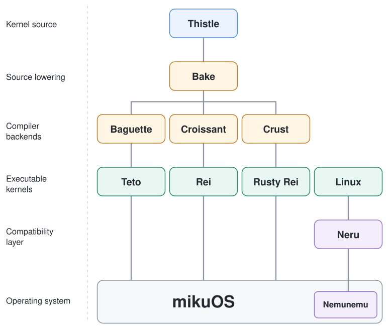

# KITTYX

**Kitty's Integrated TypeScript Toolchain Yielding a uniX-like system.**

KITTYX is a collection of independently maintained projects for systems programming, compilation and operating system development. The projects share machine and binary-format contracts where necessary, but can be used independently.

## Specifications and tools

| Project | Purpose |
| --- | --- |
| [KITTYX](https://github.com/kitty-crow/kittyx) | Machine, ABI and executable-format contracts. |
| [ThistleASM](https://github.com/kitty-crow/thistle-asm) | Assembly, linking and THO/THX binary tooling. |
| [ThistleCC](https://github.com/kitty-crow/thistlecc) | C and C++ compiler driver for compatible static RV64GC executables. |
| [Bake](https://github.com/kitty-crow/bake) | TypeScript validation and semantics-preserving source lowering. |
| [Baguette](https://github.com/kitty-crow/baguette) | Ahead-of-time TypeScript-to-WebAssembly compilation. |

## Kernels and execution

| Project | Purpose |
| --- | --- |
| [Thistle](https://github.com/kitty-crow/thistle) | Canonical TypeScript kernel. |
| [Teto](https://github.com/kitty-crow/teto) | WebAssembly kernel builds from Thistle. |
| [Neru](https://github.com/kitty-crow/neru) | Linux-WASM kernel integration. |
| [Nemunemu](https://github.com/kitty-crow/nemunemu) | THX execution and Linux compatibility. |

## Operating system

[mikuOS](https://github.com/kitty-crow/mikuOS) (初音ミクOS) provides a common userspace intended to operate across compatible kernel environments.

The diagram shows the kernel and compilation architecture, including work in development. It does not imply feature parity between them. Each repository documents its own interfaces, requirements, implementation status and licence.
